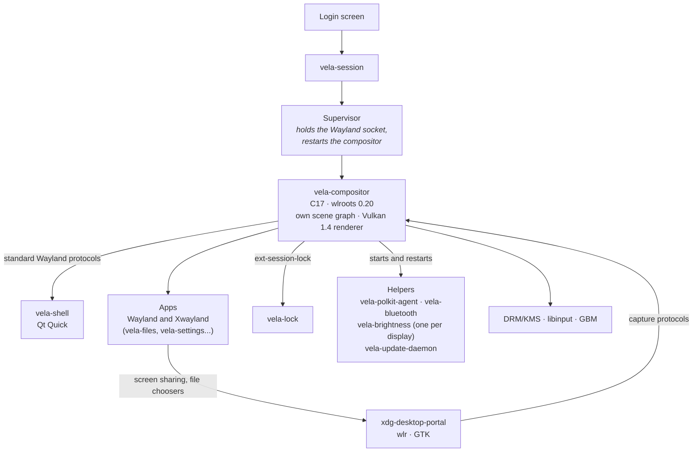

# Vela

Vela is a Linux desktop for Wayland with its own Vulkan compositor, Qt Quick
shell, file manager and settings app.

Press **Super+Z** to pick a layout, then choose the windows to fill it.
You can bring the group back together from the taskbar.

**[Install the Beta](#get-vela)** · [See screenshots](docs/features.md#screenshots)

> [!NOTE]
> **Vela is beta software.** You can pick it at the login screen and use it every day,
> but keep a working desktop or TTY available. It is tested on AMD
> and NVIDIA GPUs, and on Intel in experimental CI; read the
> [hardware coverage and known limitations](docs/hardware.md) before installing. The
> interface is available in English and Italian.

## Why Vela

- **Sharp text at 125% or 175%.** When an app draws at the display's scale,
  Vela maps its pixels directly to the screen. The sharpness tests compare
  the displayed pixels with the originals bit for bit.
- **Motion follows the monitor.** Vela times animations to the display's
  refresh cycle. Fullscreen games can use direct scanout, variable refresh
  rate and tearing where the display supports them.
- **Low idle overhead.** On the development system, the compositor used
  about 17 MiB of memory (PSS) and 0.1% of one CPU core at idle.
  [Performance measurements](docs/performance.md)

## What's inside

- **Compositor:** stacking window management with window snapping, virtual desktops, live
  window previews, blur, rounded corners and shadows, and Xwayland for X11 apps and games.
- **Shell:** taskbar, app launcher, quick settings, notifications, clipboard history,
  screenshots and desktop icons, in light and dark modes.
- **Themes** (in 0.2, on the Experimental channel today): complete looks in one click,
  Vela Expressive among them, with an accent that can follow your wallpaper's colors.
- **Files:** tabs, search, previews, archives, removable drives and safe background copies.
- **Settings:** displays, sound, network, Bluetooth, input, power, personalization,
  accessibility and updates.
- **Session:** a secure lock screen, an authorization prompt for administrator actions,
  and recovery from compositor, shell and GPU crashes. Windows stay open after a shell
  crash; after a compositor or GPU restart, Qt and KDE apps reconnect.

The [feature list](docs/features.md) has the details and more screenshots.

## Get Vela

Vela needs a GPU with **Vulkan 1.4** (AMD or Intel with Mesa ≥ 25.0, NVIDIA with the
proprietary driver ≥ 570 or NVK) and **PipeWire with WirePlumber** for sound. From 0.2
(on the Experimental channel today) it also needs an **x86-64-v3 CPU**: roughly
2017-generation hardware, though the instruction set, not the date, is what counts.
CPU and GPU requirements are independent.

Choose your distribution for the prerequisites and install commands:

- [Arch Linux, CachyOS and EndeavourOS](docs/installation.md#arch-linux-cachyos-endeavouros)
- [Fedora 44 and 45](docs/installation.md#fedora-44-and-45)
- [Ubuntu 26.10](docs/installation.md#ubuntu-2610)

The updater verifies the prebuilt Beta package with Cosign before installing it.
Then choose **Vela** at the login screen. See the [installation guide](docs/installation.md)
for Experimental, updates, rollback and [other distributions](docs/installation.md#other-distributions).

**Just want a look?** [Build from source](docs/development.md#build) and run
`sh scripts/run-nested.sh`: Vela opens in a window inside your current Wayland desktop.
Nested mode is good for exploring, but cannot validate every hardware path. For a full
session without touching your system, run Vela in a
[QEMU/KVM virtual machine with Venus](docs/virtual-machines.md) (experimental; it needs
the Experimental channel).

## How it works

- **The compositor** is built on wlroots with its own scene graph and Vulkan renderer:
  it controls the whole path from an app's commit to the pixel on the monitor, including
  frame scheduling, damage tracking and direct scanout ([renderer design](docs/renderer.md)).
- **The shell** is a separate Qt Quick process that talks to the compositor through
  standard Wayland protocols, so a shell crash never takes your windows down.
- **Small helpers** do the work that touches hardware or system services: the
  authorization prompt's agent, Bluetooth, monitor brightness over DDC/CI and the
  update checks. Each is its own process, started and restarted by the compositor, so
  a slow monitor or a stuck D-Bus call never delays a frame.
- **Vela reuses** standard Linux services and selected KDE components (themes and
  icons), and keeps app passwords in KWallet or GNOME Keyring, rather than reinventing
  them. It does not run on KDE's compositor or Plasma shell
  ([integration services](docs/hardware.md#integration-services)).

## Get involved

Vela is a young project and moves fast. Every kind of help is welcome:

- **Try it and report problems.** `vela-report` builds a diagnostic ZIP that you review
  before sharing; nothing is uploaded ([details](docs/reporting.md)).
- **Test on your hardware.** GPU, driver and multi-monitor results are especially
  valuable ([smoke tests](docs/hardware.md#suggested-manual-smoke-tests)).
- **Translate.** New languages are welcome ([how translations work](docs/development.md#translations)).
- **Contribute code.** Read the [contribution guide](CONTRIBUTING.md) and open an issue
  before larger changes. Security issues go through the [security policy](SECURITY.md).

## Community

Join the [Vela Desktop community on Matrix](https://matrix.to/#/#vela:velade.org)
for discussions, support, announcements and development. Open the Space Lobby to
browse and join the rooms you're interested in. An account from any federated
Matrix homeserver works; no `velade.org` account is required.

## Documentation

[Project website](https://velade.org) · [What's new](CHANGELOG.md) · [Roadmap](docs/roadmap.md)

[Features](docs/features.md) · [Installation and updates](docs/installation.md) ·
[Keyboard shortcuts](docs/shortcuts.md) · [Hardware coverage](docs/hardware.md) ·
[Development guide](docs/development.md) · [Renderer design](docs/renderer.md)

Everything else, from configuration to the design documents, is in the
[documentation index](docs/README.md).

## AI disclosure

AI tools are actively used in Vela's development, including code generation, review and
documentation. The project's vision, architecture and technical direction remain
human-driven, and AI-assisted code is held to the same review, testing and quality
expectations as any other contribution.

## Acknowledgements and license

Vela stands on the shoulders of [wlroots](https://gitlab.freedesktop.org/wlroots/wlroots),
[Qt](https://www.qt.io/), [KDE Frameworks and Plasma](https://kde.org/),
[Mesa](https://mesa3d.org/) and the Wayland protocols community.

Vela is free software under the [GNU General Public License](LICENSE), version 3 or
(at your option) any later version. The Wayland protocol files in `protocols/` keep
their original MIT-style licenses.
