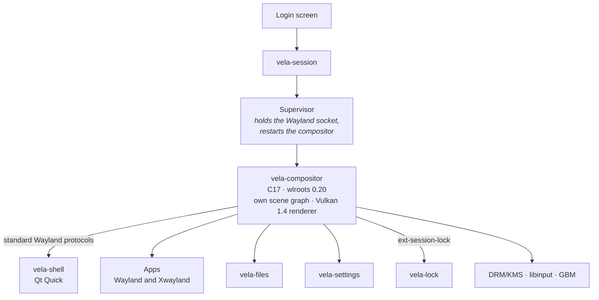

<div align="center">


# Vela

**A modern, fluid and sharp Linux desktop built for today's hardware.**

Vela is a complete desktop environment for Wayland: its own compositor and Vulkan
renderer, a Qt Quick shell, a file manager and a settings app, designed together.

[](https://github.com/vela-desktop/vela/actions/workflows/build.yml)
[](https://github.com/vela-desktop/vela/releases)
[](LICENSE)

[Website](https://velade.org) · [Get Vela](#get-vela) · [Features](docs/features.md) ·
[How it works](#how-it-works) · [Documentation](#documentation) ·
[Community](#community) · [Roadmap](docs/roadmap.md)

<br>


</div>

> [!NOTE]
> **Vela is beta software.** You can pick it at the login screen and use it every day,
> but keep a working desktop or TTY available. It is tested on AMD and NVIDIA GPUs;
> read the [hardware coverage and known limitations](docs/hardware.md) before
> installing. The interface is available in English and Italian.

## Why Vela

Vela uses modern hardware where that improves the experience and avoids overhead where
it does not. Efficiency comes from doing less unnecessary work, not from making the
desktop feel less modern.

- **Modern.** Shell, window management, file manager and settings are designed as one
  desktop rather than a collection of unrelated utilities.
- **Fluid.** Animations advance on the monitor's real frames, never on arbitrary timers,
  and each frame is drawn as late as safely possible. Fullscreen games can go straight
  to the display, with VRR and tearing support.
- **Sharp.** Fractional scaling is designed around physical pixels: at 125% or 175% an
  app rendering at the screen's scale is shown 1:1 with no filtering, and an automated
  test checks this bit for bit.
- **Efficient.** Damage tracking, direct scanout and native components keep overhead
  low: the compositor idles at about 17 MiB and 0.1% of one CPU core on the development
  system ([methodology](docs/performance.md)).

## What's inside

- **Compositor:** stacking window management with window snapping, virtual desktops, live
  window previews, blur, rounded corners and shadows, and Xwayland for X11 apps and games.
- **Shell:** taskbar, app launcher, quick settings, notifications, clipboard history,
  screenshots and desktop icons, in light and dark modes.
- **Themes:** complete looks in one click, Vela Expressive among them, with an accent
  that can follow your wallpaper's colors.
- **Files:** tabs, search, previews, archives, removable drives and safe background copies.
- **Settings:** displays, sound, network, Bluetooth, input, personalization,
  accessibility and updates.
- **Session:** a secure lock screen, an authorization prompt for administrator actions,
  and recovery from compositor, shell and GPU crashes without losing your windows.

The [feature list](docs/features.md) has the details and more screenshots.

## Get Vela

Vela needs an **x86-64-v3 CPU** (roughly 2017-generation hardware; the ISA,
not the manufacturing date, is the actual requirement), a GPU with **Vulkan 1.4**
(AMD or Intel with Mesa ≥ 25.0, NVIDIA with the proprietary driver ≥ 570 or NVK),
and **PipeWire with WirePlumber** for sound. CPU and GPU requirements are independent.

Install the prerequisites for your distribution:

| Distribution | Prerequisites |
|---|---|
| Arch Linux, CachyOS, EndeavourOS | `sudo pacman -S --needed git curl base-devel cosign` |
| Fedora 44 and 45 | `sudo dnf install git curl rpm-build dnf5-plugins`, plus the [upstream Cosign RPM](docs/installation.md#fedora-44-and-45) |
| Ubuntu 26.10 (with *universe*) | `sudo apt install git ca-certificates sudo cosign` |

Then install the current Beta and choose **Vela** at the login screen:

```sh
git clone https://github.com/vela-desktop/vela.git
sh vela/packaging/vela-update --channel beta
```

Beta packages are prebuilt, signed and verified with Cosign before installing. The
[installation guide](docs/installation.md) covers the Experimental channel, updates,
rollback and [other distributions](docs/installation.md#other-distributions).

**Just want a look?** [Build from source](docs/development.md#build) and run
`sh scripts/run-nested.sh`: Vela opens in a window inside your current Wayland desktop.
Nested mode is good for exploring, but cannot validate every hardware path.

## How it works



- **The compositor** is built on wlroots with its own scene graph and Vulkan renderer:
  it controls the whole path from an app's commit to the pixel on the monitor, including
  frame scheduling, damage tracking and direct scanout ([renderer design](docs/renderer.md)).
- **The shell** is a separate Qt Quick process that talks to the compositor through
  standard Wayland protocols, so a shell crash never takes your windows down.
- **Vela reuses** standard Linux services and selected KDE components (themes, icons and
  the wallet) rather than reinventing them. It does not run on KDE's compositor or Plasma
  shell ([integration services](docs/hardware.md#integration-services)).

## Get involved

Vela is a young project and moves fast. Every kind of help is welcome:

- **Try it and report problems.** `vela-report` builds a diagnostic ZIP that you review
  before sharing; nothing is uploaded ([details](docs/reporting.md)).
- **Test on your hardware.** GPU, driver and multi-monitor results are especially
  valuable ([smoke tests](docs/hardware.md#suggested-manual-smoke-tests)).
- **Translate.** New languages are welcome ([how translations work](docs/development.md#translations)).
- **Contribute code.** Read the [contribution guide](CONTRIBUTING.md) and open an issue
  before larger changes. Security issues go through the [security policy](SECURITY.md).

## Community

Join the [Vela Desktop community on Matrix](https://matrix.to/#/#vela:velade.org)
for discussions, support, announcements and development. Open the Space Lobby to
browse and join the rooms you're interested in. An account from any federated
Matrix homeserver works; no `velade.org` account is required.

## Documentation

- **Using Vela:** [features](docs/features.md) · [installation and updates](docs/installation.md) ·
  [keyboard shortcuts](docs/shortcuts.md) · [configuration](docs/configuration.md) ·
  [hardware coverage](docs/hardware.md) · [release channels](docs/release-channels.md) ·
  [VM setup](docs/vm-fedora44-venus.md) ·
  [roadmap](docs/roadmap.md)
- **Design:** [renderer](docs/renderer.md) · [audio](docs/audio.md) ·
  [Bluetooth](docs/bluetooth.md) · [brightness](docs/brightness.md) ·
  [screen sharing](docs/screen-sharing.md) · [theme system](docs/theme-system.md) ·
  [authorization prompt](docs/polkit-agent.md) · [updates](docs/updates.md) ·
  [compositor security model](docs/security-model.md)
- **Developing:** [development guide](docs/development.md) · [testing](docs/testing.md) ·
  [performance methodology](docs/performance.md) · [CI and quality](docs/ci-quality.md) ·
  [contributors](CONTRIBUTORS.md)

All documents live in [`docs/`](docs).

## AI disclosure

AI tools are actively used in Vela's development, including code generation, review and
documentation. The project's vision, architecture and technical direction remain
human-driven, and AI-assisted code is held to the same review, testing and quality
expectations as any other contribution.

## Acknowledgements and license

Vela stands on the shoulders of [wlroots](https://gitlab.freedesktop.org/wlroots/wlroots),
[Qt](https://www.qt.io/), [KDE Frameworks and Plasma](https://kde.org/),
[Mesa](https://mesa3d.org/) and the Wayland protocols community.

Vela is free software under the [GNU General Public License](LICENSE), version 3 or
(at your option) any later version. The Wayland protocol files in `protocols/` keep
their original MIT-style licenses.
